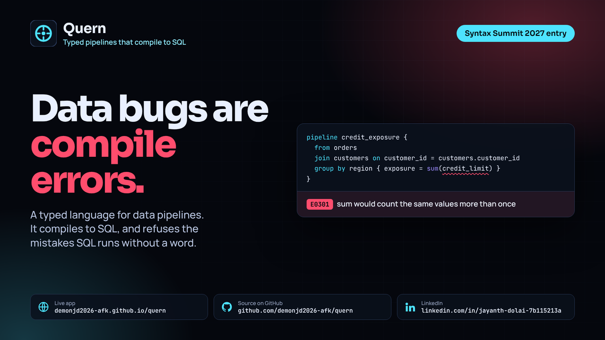
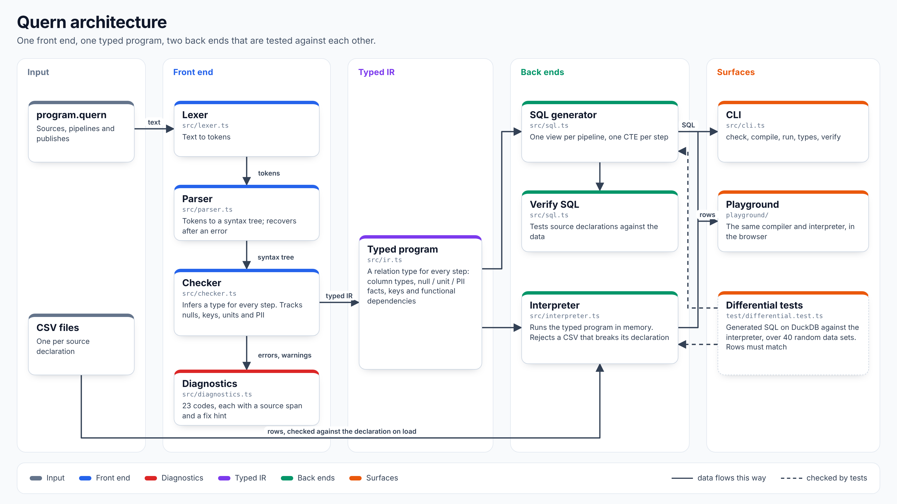

<p align="center">
  <a href="https://youtu.be/UxnmX8paP7I"></a>
</p>

<h1 align="center">Quern</h1>

<p align="center"><strong>Data bugs are compile errors.</strong><br>
A small typed language for data pipelines. It compiles to SQL, and refuses to compile the mistakes SQL runs without a word: double-counted totals, rows lost to nulls, dollars added to grams, and personal data in a public table.</p>

<p align="center">
  <a href="https://demonjd2026-afk.github.io/quern/"><strong>Live playground</strong></a> ·
  <a href="https://youtu.be/UxnmX8paP7I"><strong>Demo video</strong></a> ·
  <a href="#try-it"><strong>Try it</strong></a> ·
  <a href="#the-language-in-one-example"><strong>The language</strong></a>
</p>

<p align="center">
  <a href="https://github.com/demonjd2026-afk/quern/actions/workflows/ci.yml"></a>
  <a href="https://github.com/demonjd2026-afk/quern/actions/workflows/pages.yml"></a>
  
  
  
  <a href="LICENSE"></a>
</p>

Built by [Jayanth Dolai](https://www.linkedin.com/in/jayanth-dolai-7b115213a/) for the **Syntax Summit** hackathon on Devpost, whose challenge is to design and build a domain-specific language. Quern's domain is data pipelines.

## Demo video

**[▶ Watch on YouTube (2:40)](https://youtu.be/UxnmX8paP7I)**: a join that double-counts and the one-click fix, the generated SQL, nulls, units and personal data, editing the data, and how the compiler is built and tested.

## Contents

- [Demo video](#demo-video)
- [At a glance](#at-a-glance)
- [The problem](#the-problem)
- [What the type system tracks](#what-the-type-system-tracks)
- [Architecture](#architecture)
- [Playground](#playground)
- [Try it](#try-it)
- [The language in one example](#the-language-in-one-example)
- [Tests](#tests)
- [Security](#security)
- [Project layout](#project-layout)
- [Limits, stated plainly](#limits-stated-plainly)
- [Related work](#related-work)
- [Status](#status)
- [License](#license)

## At a glance

| | |
|---|---|
| **What it is** | A typed language for data pipelines that compiles to DuckDB SQL |
| **What it catches** | Joins that multiply rows, sums over repeated values, unhandled nulls, mixed units, and personal data sent to a public sink, all before any data runs |
| **How you see it** | 23 diagnostics, each with a code, the exact source position and a hint for the fix |
| **Two back ends** | A SQL generator and an interpreter that runs the same typed program |
| **Proof** | 84 tests. Every test pipeline runs through both back ends over the example data and 40 random data sets, and the rows must match |
| **Where it runs** | A command-line tool on Node 22 or later, and a browser playground that makes no network requests |
| **Stack** | TypeScript with no runtime dependencies. The playground is React and Vite on GitHub Pages |

## The problem

SQL will happily run a query that double-counts revenue, drops the rows with a null in them, adds dollars to grams, or copies email addresses into a public table. Each of those is a wrong answer, not an error, so it is found later, by someone looking at a dashboard.

Quern is a small language for writing the same pipelines in which those four mistakes do not type-check.

```
pipeline credit_exposure {
  from orders
  join customers on customer_id = customers.customer_id
  group by region { exposure = sum(credit_limit) }
}
```

```
error[E0301]: sum would count the same values more than once: the join repeats each 'customers' row once per matching input row
  --> examples/shop/bugs.quern:34:36
   |
34 |   group by region { exposure = sum(credit_limit) }
   |                                    ^^^^^^^^^^^^
   = hint: aggregate this column before the join, or use an expression that includes a column at the current grain
```

## What the type system tracks

A column's type is its base type (`int`, `float`, `text`, `bool`, `date`) plus four facts that the compiler carries through every step.

| Fact | Declared as | What is rejected |
| --- | --- | --- |
| **Nullability** | `discount: float<USD>?` | Comparing, filtering on, joining on, or aggregating a value that may be null. Handle it with `??`, `is null`, or `where x is not null`, which narrows the type for the steps that follow. |
| **Keys and grain** | `order_id: int key`, `key (order_id, line_no)` | A join that can multiply rows unless it says `join many`. `sum` or `avg` over a column whose rows a join has repeated. |
| **PII** | `email: text pii` | Publishing a PII-derived column to a `public` sink. `hash(...)` is the only function that clears the mark. |
| **Units** | `amount: float<USD>`, `weight: int<g>` | Adding or comparing values in different units, including a bare literal: write `100 USD`, not `100`. |

Three further rules follow from the same idea:

- Division by zero gives null, so a quotient is nullable unless the divisor is a non-zero literal.
- `sum`, `avg`, `min` and `max` over a whole table (a `group` with no keys) are nullable, because the table may be empty. With group keys they are not.
- `limit` needs an `order by` directly before it, and the compiler warns when the order can have ties.

## Architecture



The compiler is written in TypeScript with no runtime dependencies. `compile()` is a pure function from text to diagnostics, typed program and SQL, so it runs in a browser as well as in Node.

There are two back ends on purpose. The SQL generator is the product. The interpreter is the oracle: the test suite runs every test pipeline through both and requires identical rows. That check has already caught a real defect during development (the SQL read CSV columns by position while the interpreter read them by name).

### What the guarantees rest on

The checker reasons from what each `source` declares. If a file breaks a declaration (a null in a non-null column, a repeated key), the conclusions do not hold. So the declarations are checked against the data: the interpreter refuses such a file when it loads it, and `quern verify` emits a SQL query that returns one row per violated declaration.

## Playground

Live at **https://demonjd2026-afk.github.io/quern/**. The compiler and the interpreter run in the page.

| Tab | What it shows |
| --- | --- |
| **Playground** | An editor with five pipelines that SQL runs without complaint, the diagnostic Quern gives for each, a one-click fix, and the generated SQL, result rows and inferred types for whatever you type |
| **Language** | The full reference: declarations, column types, pipeline steps, operators, functions and all 23 diagnostics |
| **Checks** | Each rule as a before and after pair. The verdict under each snippet is computed by the compiler when the page loads |
| **Internals** | The compiler stages and how the two back ends are tested against each other |

The data is editable too. The Data tab shows the sample files as tables and as CSV text; change a value and the results change, blank a non-null value or repeat a key and the load is rejected. You can add a file of your own and have a `source` declaration drafted from its header and rows. Reset console puts everything back.

```sh
npm install
npm run playground          # dev server
npm run playground:build    # static site in dist-playground/
```

## Try it

Requires Node 22 or later.

```sh
npm install
npm test

npm run quern -- check   examples/shop/bugs.quern    # five bugs, five errors
npm run quern -- run     examples/shop/shop.quern    # execute with the interpreter
npm run quern -- compile examples/shop/shop.quern    # print the generated SQL
npm run quern -- types   examples/shop/shop.quern    # inferred types and keys
npm run quern -- verify  examples/shop/shop.quern    # SQL that tests the source declarations
```

[`examples/shop/shop.quern`](examples/shop/shop.quern) is a complete program. [`examples/shop/bugs.quern`](examples/shop/bugs.quern) holds five pipelines that look reasonable, run without complaint as SQL, and are each wrong.

## The language in one example

```
source orders from "data/orders.csv" {
  order_id:    int key,
  customer_id: int,
  placed_on:   date,
  amount:      float<USD>,
  discount:    float<USD>?,
  shipped:     bool,
}

pipeline shipped_orders {
  from orders
  where shipped and placed_on >= @2026-10-01
  let net = amount - discount ?? 0 USD
}

pipeline revenue_by_region {
  from shipped_orders
  join customers on customer_id = customers.customer_id
  group by region {
    revenue = sum(net),
    orders  = count(),
  }
  order by revenue desc
}

publish revenue_by_region to public "out/revenue_by_region.csv"
```

A program is a list of `source`, `pipeline` and `publish` declarations. Sources may be declared anywhere in the file; a pipeline must be defined before another one reads it. A pipeline is a `from` followed by steps, read top to bottom:

| Step | Form |
| --- | --- |
| `join` | `[left] join [many] <relation> on a = <relation>.b [and ...]` |
| `where` | `where <bool expression>` |
| `let` | `let name = <expression>` (adds a column; never overwrites one) |
| `select` | `select a, b, name = <expression>` |
| `group` | `group [by a, b] { name = <aggregate>(...), ... }` |
| `order by` | `order by a [desc], b` (last step, or directly before `limit`) |
| `limit` | `limit n` |

Operators, loosest to tightest: `or`, `and`, `not`, comparisons and `is [not] null`, `+ -`, `* /`, `??`, unary `-`.
Scalar functions: `hash`, `lower`, `upper`, `abs`, `round`, `convert(value, UNIT, rate)`.
Aggregates: `sum`, `avg`, `min`, `max`, `count()`, `count_distinct`.

## Tests

```sh
npm test          # 84 tests
npm run typecheck
```

| File | What it covers |
| --- | --- |
| `test/diagnostics.test.ts` | A program that triggers each of the 23 diagnostic codes. The suite fails if a code in the catalogue has no case |
| `test/types.test.ts` | Type inference: nullability and narrowing, keys and grain, units, PII, declaration order |
| `test/interpreter.test.ts` | The interpreter's results, and its refusal of a CSV that breaks a source declaration |
| `test/differential.test.ts` | Generated SQL on DuckDB against the interpreter, over the example data and 40 seeded random data sets |
| `test/infer.test.ts` | Drafting a `source` declaration from a CSV file in the playground |

CI runs the type check, the tests and the build on every push. A second workflow runs the tests again, builds the playground and deploys it to GitHub Pages.

## Security

- The compiler has no runtime dependencies. DuckDB is a development dependency, used only by the differential tests.
- The playground is a static site. Its Content Security Policy sets `connect-src 'none'`, so the page cannot make a network request, and scripts load only from the site itself.
- Code and data typed into the playground stay in the page. Data files are capped at 8 files of 200 kB each.
- `npm audit` reports no known vulnerabilities at the time of writing.

## Project layout

```
src/
  lexer.ts          text to tokens
  parser.ts         tokens to a syntax tree, with error recovery
  ast.ts            syntax tree types
  checker.ts        type checker: nulls, keys and grain, units, PII
  ir.ts             the typed program both back ends read
  sql.ts            DuckDB SQL generator and the verify query
  interpreter.ts    runs the typed program in memory, loads and checks CSV
  diagnostics.ts    the 23 diagnostic codes and their rendering
  md5.ts            the hash behind hash(), matching DuckDB's md5
  index.ts          compile(): text in, diagnostics, typed program and SQL out
  cli.ts            check, compile, run, types, verify
test/               84 tests, described above
examples/shop/      a complete program, five deliberate bugs, sample CSV data
playground/         the browser playground (React, Vite)
docs/               architecture diagram and demo thumbnail
.github/workflows/  CI, and the GitHub Pages deploy
```

## Limits, stated plainly

- PII tracking follows explicit flows only (values computed from a PII column). It does not track what a `where` on a PII column reveals about the rows that remain.
- The duplication rule is conservative by design and has one heuristic: an expression is treated as safe to sum if at least one column in it is at the current grain (`quantity * price` after joining products to order lines).
- `float` is a 64-bit float and `int` is exact up to 2^53 in the interpreter. There is no fixed-point decimal type yet.
- Units are single names. There are no compound units such as `USD/kg`.
- The SQL target is DuckDB. Sources are CSV files.
- A group output is a single aggregate call; ratios of aggregates go in a `let` after the group.

## Related work

The ideas here are not new one by one, and Quern does not claim they are. Units of measure in a type system are well known from F#. Typing queries for information flow was done in SeLINQ (Schoepe, Hedin and Sabelfeld, ICFP 2014). Encoding grain in types to catch fan traps before running anything is the subject of "Grain-Aware Data Transformations" (Karayannidis, arXiv:2601.00995). What Quern contributes is putting these checks together in one small standalone language with a working compiler, an interpreter, and error messages aimed at the person writing the pipeline.

## Status

Built for the Syntax Summit hackathon. Working today: the compiler, the interpreter, the command-line tool, the browser playground with its language reference, and the test suite. Not built yet: editor support for `.quern` files.

## License

[MIT](LICENSE)
